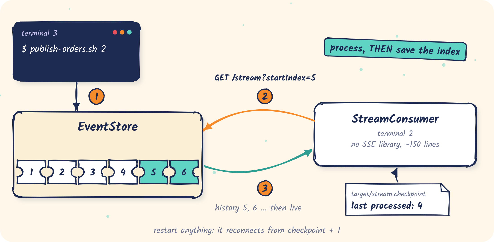

# 02 · Pull: a resumable stream consumer

A consumer that reads the log over SSE, remembers how far it got, and continues from there after
it restarts, after EventStore restarts, or after the network drops.

<p align="center"></p>

Code: [`StreamConsumer.java`](src/main/java/com/fifteen02/eventstore/samples/pull/StreamConsumer.java),
with no SSE library and no EventStore dependency.

## The idea

With pull, **the client owns its position**. EventStore keeps no state for a stream. The consumer:

1. reads its checkpoint, the last index it processed (0 if none);
2. connects with `startIndex = checkpoint + 1`;
3. for each message: processes it, **then** saves `id` as the new checkpoint;
4. when the connection drops: waits two seconds and goes back to 1.

Step 3's order matters. If the process dies between processing and saving, the message is
processed again on restart, but it is never skipped. That is at-least-once, so keep processing
idempotent.

## Run it

EventStore with no extra config:

```bash
samples/bin/run-eventstore.sh
```

The consumer:

```bash
mvn -q -f samples/02-pull-stream compile exec:java
```

Some traffic, in a third terminal:

```bash
samples/bin/publish-orders.sh 2
```

```text
stream: checkpoint file …/samples/02-pull-stream/target/stream.checkpoint
stream: connected from 1, server is at 4
stream: #1 StartMarker    user=system     {}   (3 behind)
stream: #2 OrderPlaced    user=customer-1 {"total":49.9,"orderId":"order-1791800693-26411"}   (2 behind)
stream: #3 OrderShipped   user=customer-2 {"total":49.9,"orderId":"order-1791800693-19084"}   (1 behind)
stream: #4 OrderPlaced    user=           {"orderId":"same"}
stream: #5 OrderPlaced    user=customer-1 {"orderId":"order-1791800707-23589-1","total":10}
stream: #6 OrderShipped   user=customer-1 {"orderId":"order-1791800707-23589-1","carrier":"DHL"}
…
```

The first lines are **replay**: they were stored before the consumer connected, and
`(n behind)` counts down as it catches up. Everything after that is **live**, on the same
connection.

## Resume

Stop the consumer (Ctrl+C), publish while it is down, and start it again:

```bash
samples/bin/publish-orders.sh 1
```

```bash
mvn -q -f samples/02-pull-stream exec:java
```

```text
stream: connected from 11, server is at 12
stream: #11 OrderPlaced    user=customer-1 {"total":10,"orderId":"order-1791800727-13614-1"}   (1 behind)
stream: #12 OrderShipped   user=customer-1 {"carrier":"DHL","orderId":"order-1791800727-13614-1"}
```

It picked up exactly where it stopped. Restarting EventStore instead works the same way: the
consumer prints `reconnecting in 2s` and continues.

## Options

| Variable | Effect |
|---|---|
| `STREAM_TYPES=OrderPlaced,OrderCancelled` | receive only these types (server-side filter) |
| `END_INDEX=100` | stop at index 100: a bounded replay |
| `CHECKPOINT_FILE=/tmp/x` | keep the checkpoint elsewhere; delete it to start from 1 again |

For example, every `OrderPlaced` up to index 4, into a separate checkpoint:

```bash
CHECKPOINT_FILE=/tmp/placed.cp END_INDEX=4 STREAM_TYPES=OrderPlaced mvn -q -f samples/02-pull-stream exec:java
```

```text
stream: connected from 1, server is at 10
stream: #2 OrderPlaced    user=customer-1 {"total":49.9,"orderId":"order-1791800693-26411"}   (8 behind)
stream: #4 OrderPlaced    user=           {"orderId":"same"}   (6 behind)
stream: ended at 4 (endIndex reached)
```

## Things to know

- Use `startIndex`, not the SSE `Last-Event-ID` header; EventStore ignores that header.
- Browsers' `EventSource` cannot send the `Authorization` header. Use `fetch()` with a
  streaming reader.
- With a filter, the checkpoint only moves when a matching message arrives, so a reconnect may
  rescan some filtered-out messages. That is harmless.

## What's next

Here the client remembers its position. In [03](../03-push-replayable), EventStore remembers it
for you and **pushes** messages over AMQP.
