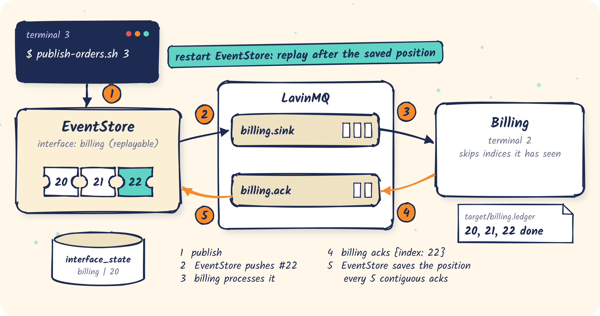

# 03 · Push: a replayable interface

A billing service that EventStore **pushes** orders to over AMQP. EventStore tracks how far
billing has acknowledged and, after a restart, replays from there.

<p align="center"></p>

- Config: [`eventstore.yml`](eventstore.yml), one `replayable` interface named `billing`
- Code: [`BillingConsumer.java`](src/main/java/com/fifteen02/eventstore/samples/replayable/BillingConsumer.java)

## The idea

An **interface** is a consumer declared in EventStore's configuration:

```yaml
eventstore:
  amqp:
    enabled: true
  interfaces:
    - name: billing
      type: replayable
      include-types: [OrderPlaced, OrderCancelled]
      sink: { amqp: { virtual-host: / } }
      ack:  { amqp: { virtual-host: / }, batch: 5 }
```

EventStore declares two queues: it publishes to `billing.sink`, and billing answers on
`billing.ack`. For each message, billing does three things:

1. **processes** it, skipping any index it has already processed;
2. **acks to EventStore**: publishes `{"index": 42, "serverCorrelationUUID": "…"}` to
   `billing.ack`, with the same `serverCorrelationUUID` as a **header**;
3. **acks to the broker**: `basicAck` on the `billing.sink` delivery.

Ack 2 moves billing's position in EventStore. Ack 3 removes the message from the queue. You
need both.

## Run it

EventStore with this sample's config:

```bash
samples/bin/run-eventstore.sh 03-push-replayable
```

```text
Declared sink queue 'billing.sink' for interface 'billing' on vhost '/'
Declared ack queue 'billing.ack' for interface 'billing' on vhost '/'
Interface [replayable] 'billing' started and ready to receive messages
Interface billing catch-up completed: processed 6 messages, skipped 7 messages, reached message ID 13
```

This is the interface's first start, and the log already holds 13 messages from samples 01 and
02. A replayable interface **starts from the beginning**: it pushed the 6 matching messages and
auto-acknowledged the 7 it filters out.

The consumer:

```bash
mvn -q -f samples/03-push-replayable compile exec:java
```

```text
billing: consuming billing.sink, acknowledging on billing.ack, 0 already processed (Ctrl+C to stop)
billing: #2 OrderPlaced    user=customer-1 {"total":49.9,"orderId":"order-1791800693-26411"}
billing: #4 OrderPlaced    user=null       {"orderId":"same"}
billing: #5 OrderPlaced    user=customer-1 {"total":10,"orderId":"order-1791800707-23589-1"}
…
```

Publish, and the new orders arrive live:

```bash
samples/bin/publish-orders.sh 3
```

```text
billing: #14 OrderPlaced    user=customer-1 {"orderId":"order-1791800755-8182-1","total":10}
billing: #16 OrderPlaced    user=customer-2 {"orderId":"order-1791800755-8182-2","total":20}
billing: #18 OrderPlaced    user=customer-0 {"orderId":"order-1791800755-8182-3","total":30}
billing: #20 OrderCancelled user=customer-0 {"orderId":"order-1791800755-8182-3","reason":"changed mind"}
```

Look at billing's saved position:

```bash
docker exec eventstore-sample-postgres psql -U eventstore -tAc 'select name, last_acknowledged_id from interface_state'
```

```text
billing|20
```

## Consumer down

Stop the consumer, then publish. The messages wait in `billing.sink` (see the LavinMQ UI). Start
the consumer again and it drains them. Nothing is lost while the consumer is away.

## EventStore restart: at-least-once in action

The position is saved every `batch` (here 5) **contiguous** acknowledged indices. Publish two
more orders, so billing is ahead of its last saved position, then restart EventStore (Ctrl+C, then run it
again) while the consumer keeps running:

```text
Interface billing catch-up completed: processed 2 messages, skipped 3 messages, reached message ID 25
```

EventStore replayed everything after the saved position, including two orders billing had
already processed:

```text
billing: #21 duplicate, skipped
billing: #23 duplicate, skipped
```

That is **at-least-once** delivery. The consumer keeps a small ledger of processed indices in
`target/billing.ledger`, keyed by the `messageId` header (the global index), which makes
reprocessing harmless. It still acknowledges duplicates, so the position keeps moving. Your real
consumer needs the same thing, usually a unique constraint or an "already applied" check in
your own database.

## Things to know

- Replayed messages are appended **behind** whatever is already waiting in `billing.sink`, so
  after a restart a slow consumer may see an index again, and see it after a higher one.
- Acks may arrive in any order. EventStore only advances over contiguous indices.
- Acks from before an EventStore restart carry the old `serverCorrelationUUID` and are discarded.
  The replay covers them.
- Several consumers can share `billing.sink` (competing consumers); ordering across them is then
  not guaranteed.
- `batch` trades redelivery for database writes. The default is 1000.

Try `SLOW_MS=500` to watch messages queue up behind a slow consumer.

## What's next

Not every consumer needs this much guarantee. [04](../04-push-realtime) is the fire-and-forget version.
