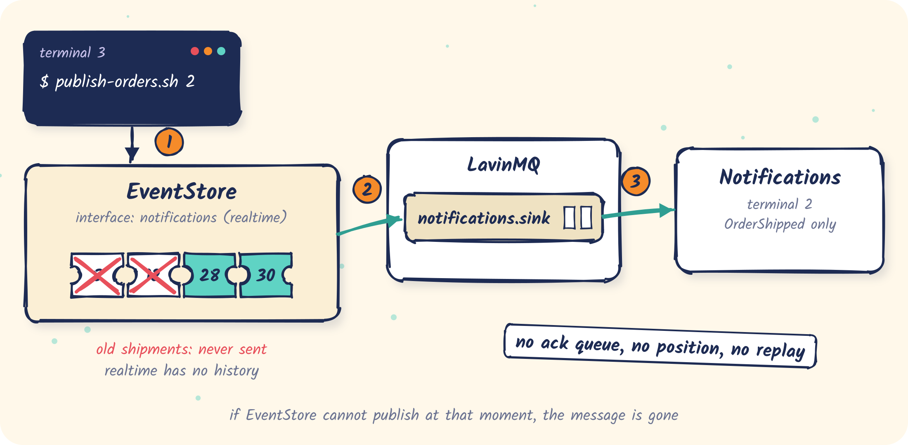

# 04 · Push: a realtime interface

A notifications service that gets `OrderShipped` events pushed as they happen, with no
acknowledgements and no replay.

<p align="center"></p>

- Config: [`eventstore.yml`](eventstore.yml), one `realtime` interface named `notifications`
- Code: [`NotificationsConsumer.java`](src/main/java/com/fifteen02/eventstore/samples/realtime/NotificationsConsumer.java)

## The idea

```yaml
eventstore:
  amqp:
    enabled: true
  interfaces:
    - name: notifications
      type: realtime
      include-types: [OrderShipped]
      sink: { amqp: { virtual-host: / } }
```

A realtime interface publishes each matching message to `notifications.sink` once, at the moment
it is stored. There is no `notifications.ack`, no saved position and no catch-up. The consumer
only acks to the broker.

Compared with [03](../03-push-replayable):

| | replayable | realtime |
|---|---|---|
| First start | pushes the whole history | pushes only new messages |
| EventStore restart | replays after the last saved position | nothing is replayed |
| Consumer acks to EventStore | required | not allowed (startup fails if configured) |
| Good for | billing, projections, anything that must see everything | notifications, cache invalidation, live dashboards |

## Run it

```bash
samples/bin/run-eventstore.sh 04-push-realtime
```

```text
Declared sink queue 'notifications.sink' for interface 'notifications' on vhost '/'
Interface [realtime] 'notifications' started and ready to receive messages
```

```bash
mvn -q -f samples/04-push-realtime compile exec:java
```

```text
notifications: consuming notifications.sink (Ctrl+C to stop)
```

Nothing arrives, even though the log already holds plenty of `OrderShipped` events from the
earlier samples. Realtime never sees history. Now publish:

```bash
samples/bin/publish-orders.sh 2
```

```text
notifications: #28 OrderShipped   user=customer-1 {"orderId":"order-1791800797-14524-1","carrier":"DHL"}
notifications: #30 OrderShipped   user=customer-2 {"orderId":"order-1791800797-14524-2","carrier":"DHL"}
```

## When messages are lost

`notifications.sink` is a durable queue. If only the **consumer** is down, messages wait there
as usual. A realtime interface drops messages when **EventStore** misses its chance to publish:
the broker is unreachable at that moment, the queue has been deleted, or the interface was added
later (no history). If you can't tolerate that, use `replayable`.

## What's next

So far each consumer has been a single process. [05](../05-sharded-readers) splits the log
across several readers.
