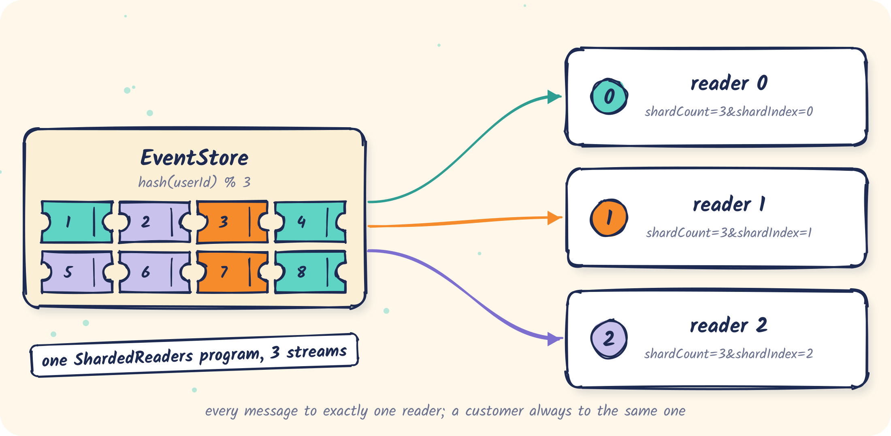

# 05 · Sharded readers

Split the log across N pull readers so each one handles a slice of the users, with no overlap
and no gaps.

<p align="center"></p>

Code: [`ShardedReaders.java`](src/main/java/com/fifteen02/eventstore/samples/sharded/ShardedReaders.java)

## The idea

Any SSE stream can ask for one shard:

```text
GET /api/events/stream?startIndex=1&shardCount=3&shardIndex=0
GET /api/events/stream?startIndex=1&shardCount=3&shardIndex=1
GET /api/events/stream?startIndex=1&shardCount=3&shardIndex=2
```

EventStore hashes each message's `userId` (murmur3) and delivers it only to the reader whose
`shardIndex` matches. As a result:

- every message goes to **exactly one** reader;
- all messages of a user go to the **same** reader, in order, so per-user state stays local;
- messages without a `userId` all land in one shard.

Each reader keeps its own checkpoint, exactly like [02](../02-pull-stream).

## Run it

EventStore with no extra config, and some traffic spread over 50 customers:

```bash
samples/bin/run-eventstore.sh
```

```bash
CUSTOMERS=50 samples/bin/publish-orders.sh 100
```

Three readers over the whole log:

```bash
mvn -q -f samples/05-sharded-readers compile exec:java
```

```text
reading indices 1..292 with 3 shard readers

shard 0: 115 messages  {customer-0=…, customer-12=…, …}
shard 1:  64 messages  {…}
shard 2: 113 messages  {…}

total 292 distinct of 292 stored, 0 delivered twice
```

Every stored message was delivered once, to one reader.

## Skew

Shards are by user, not by message. Few users, or one very busy user, means uneven shards. With
only the three customers of the earlier samples:

```text
reading indices 1..59 with 3 shard readers

shard 0:  33 messages  {(no user)=1, customer-0=15, customer-2=17}
shard 1:   0 messages  {}
shard 2:  26 messages  {customer-1=21, system=5}
```

Shard 1 gets nothing. Pick `shardCount` for your real user population, and expect a busy user
to make their shard busy.

`SHARDS=2` runs two readers instead of three.

## Changing the shard count

Changing `shardCount` moves users between shards. Each reader's checkpoint belongs to its old
slice, so treat a resize as a new deployment: start all readers of the new layout from the
**lowest** old checkpoint, and make processing idempotent so the overlap is harmless.

## What's next

Every message so far was published over REST. [06](../06-amqp-producer) publishes through AMQP instead.
