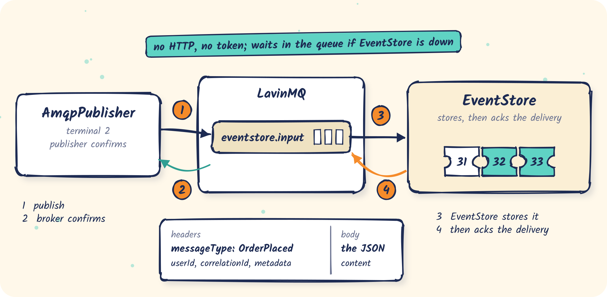

# 06 · Publishing over AMQP

Send messages to EventStore through an AMQP queue instead of the REST API.

<p align="center"></p>

- Config: [`eventstore.yml`](eventstore.yml), which enables AMQP and the `eventstore.input` queue
- Code: [`AmqpPublisher.java`](src/main/java/com/fifteen02/eventstore/samples/producer/AmqpPublisher.java)

## Why

Producers that already talk to a broker don't need an HTTP client or EventStore's token. They
also keep working while EventStore restarts: messages wait in the input queue and are ingested
when it is back.

What you give up: there is no reply, so the producer never learns the index it was given.

## The message

The **body** is the content, as JSON. Everything else is a **header**. Names are constants in
`com.fifteen02.eventstore.constants.MessageHeaders` (in `eventstore-common`):

| Header | Required | Value |
|---|---|---|
| `messageType` | **yes** | e.g. `OrderPlaced` |
| `userId` | no | used by SSE filters and sharding |
| `correlationId` | no | stored as-is |
| `timestamp` | no | ISO-8601 or epoch millis; defaults to now |
| `metadata` | no | a JSON object **encoded as a string** |

```java
headers.put(MessageHeaders.MESSAGE_TYPE, "OrderPlaced");
headers.put(MessageHeaders.USER_ID, "customer-1");
headers.put(MessageHeaders.METADATA, "{\"source\":\"amqp-publisher-sample\"}");

channel.basicPublish("", "eventstore.input", properties, json.writeValueAsBytes(content));
```

## Run it

```bash
samples/bin/run-eventstore.sh 06-amqp-producer
```

```text
Declared input queue 'eventstore.input' for interface 'eventstore' on vhost '/'
```

```bash
mvn -q -f samples/06-amqp-producer compile exec:java
```

```text
published OrderPlaced    user=customer-1 {orderId=order-f5fb602e-1, total=10}
published OrderShipped   user=customer-1 {orderId=order-f5fb602e-1, carrier=DHL}
…
published OrderCancelled user=customer-0 {orderId=order-f5fb602e-3, reason=changed mind}
all messages confirmed by the broker
```

They are now in the log with their headers mapped to fields:

```bash
samples/01-quickstart/stream.sh messageType=OrderCancelled
```

The program uses **publisher confirms**, so "confirmed" means the broker has the messages
durably. EventStore acknowledges each input message only after storing it.

## Things to know

- **Always set `messageType`.** A message without it is rejected and never stored. Give the
  input queue a dead-letter policy on the broker if you want to keep such messages for inspection.
- A body that is not JSON, or `metadata` that is not a JSON object, is rejected the same way
  and never stored.
- Bodies must differ. Identical bodies are dropped as duplicates (see [01](../01-quickstart#duplicates)).
- To deliver these messages onwards over AMQP, add interfaces to the same config
  (see [03](../03-push-replayable)).

## What's next

[07](../07-projection) folds the log into state that survives crashes and can be served to others.
