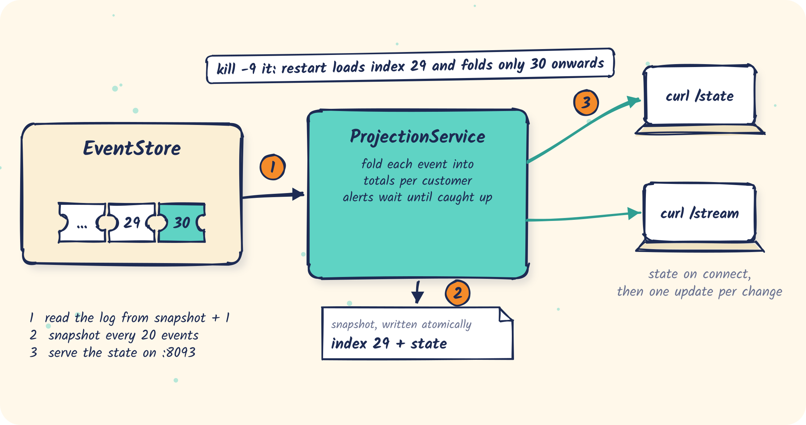

# 07 · A projection with snapshots

A small service that folds order events into "orders per customer", survives crashes without
re-reading the whole log, holds back side effects while it catches up, and serves its state to
its own subscribers.

<p align="center"></p>

Code:
- [`OrderProjection.java`](src/main/java/com/fifteen02/eventstore/samples/projection/OrderProjection.java): the fold, the state and the snapshot
- [`ProjectionService.java`](src/main/java/com/fifteen02/eventstore/samples/projection/ProjectionService.java): consuming the log, snapshots, alerts, and serving `/state` and `/stream`

## The idea

A **projection** is a fold over the log: start from an empty state and apply each event in index
order. Here the state is one row of totals per customer:

```text
OrderPlaced    -> placed + 1, spent + total
OrderShipped   -> shipped + 1
OrderCancelled -> cancelled + 1, spent - (total of that order)
```

A **snapshot** is the pair (index, state): "this is the state after folding events 1..index". It
is written atomically (temp file, then rename), so the index and the state can never disagree. On
restart the service loads the snapshot and asks EventStore for `startIndex = index + 1`. It folds
only what happened since, never the whole log. The fold also ignores any event at or below its
index, so a re-delivered event changes nothing.

## Run it

```bash
samples/bin/run-eventstore.sh
```

Some history first:

```bash
CUSTOMERS=4 samples/bin/publish-orders.sh 12
```

```bash
mvn -q -f samples/07-projection compile exec:java
```

```text
projection: serving http://localhost:8093/state and /stream
projection: loaded snapshot at index 0 from …/samples/07-projection/target/projection.snapshot.json
projection: connected from 1, log is at 29
projection: snapshot at index 20
projection: caught up at index 29 (4 alerts suppressed during catch-up)
projection: snapshot at index 29
```

```bash
curl -s localhost:8093/state
```

```text
{"index":29,
 "customers":{"customer-0":{"placed":3,"shipped":3,"cancelled":1,"spent":120}, …},
 "totals":{"placed":12,"shipped":12,"cancelled":4,"spent":480},
 "caughtUp":true}
```

`totals` is a coarser view derived from the per-customer rows by adding them up, without
re-reading any events.

## Side effects wait until caught up

The service raises an alert when a customer's spend crosses 100 (`VIP_THRESHOLD`). During
catch-up it is replaying the past, and an alert about last week is noise, so those are counted
and suppressed (`4 alerts suppressed during catch-up`). Once caught up, alerts fire:

```bash
CUSTOMERS=6 samples/bin/publish-orders.sh 12
```

```text
projection: ALERT customer-1 is now a VIP (spent 150)
projection: ALERT customer-4 is now a VIP (spent 140)
projection: ALERT customer-5 is now a VIP (spent 160)
```

The catch is that a threshold crossed while the service was **down** is also "the past" on
restart, so it never alerts. If every crossing must alert exactly once, make the alert part of the
state (record "alerted" per customer in the snapshot), or give alerts their own consumer with its
own position, such as a replayable interface ([03](../03-push-replayable)).

## Serving the state: snapshot on connect, then updates

```bash
curl -N localhost:8093/stream
```

```text
event:snapshot
data:{"index":29,"customers":{…},"totals":{"placed":12,"shipped":12,"cancelled":4,"spent":480},"caughtUp":true}

event:update
data:{"index":30,"customer":"customer-1","stats":{"placed":4,"shipped":3,"cancelled":1,"spent":70},"totals":{…,"spent":490}}

event:heartbeat
data:{"index":33,"caughtUp":true}
```

A subscriber gets the **current** state on connect, then one `update` per change. It has no
position to keep and nothing to replay: the projection did the folding once, for everyone.

## Crash test

Kill the service with `kill -9` while orders are being published, then start it again:

```text
projection: loaded snapshot at index 109 from …/projection.snapshot.json
projection: connected from 110, log is at 411
projection: snapshot at index 129
…
projection: caught up at index 411 (8 alerts suppressed during catch-up)
```

Now compare with a second instance that recomputes everything from index 1:

```bash
SNAPSHOT_FILE=/tmp/fresh.json PORT=8094 mvn -q -f samples/07-projection exec:java
```

Once it says `caught up`, ask both for their state and compare the `customers` and `totals`; the
resumed one and the recomputed one should be identical:

```bash
curl -s localhost:8093/state
curl -s localhost:8094/state
```

## Options

| Variable | Default | Effect |
|---|---|---|
| `SNAPSHOT_EVERY` | 20 | events between snapshots: higher means fewer writes, more to re-fold after a crash |
| `VIP_THRESHOLD` | 100 | spend that triggers the alert |
| `PORT` | 8093 | where `/state` and `/stream` are served |
| `SNAPSHOT_FILE` | `target/projection.snapshot.json` | delete it to rebuild from index 1 |
